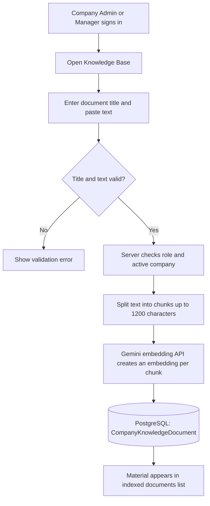
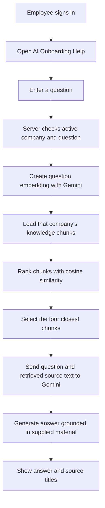
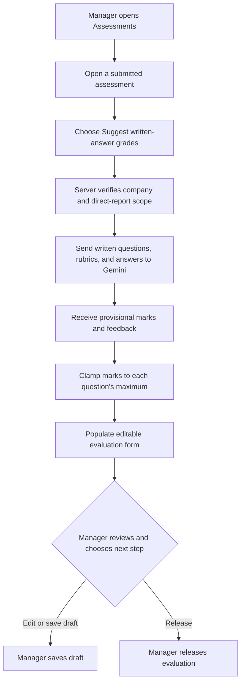
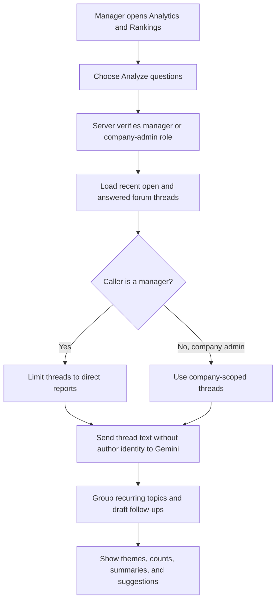
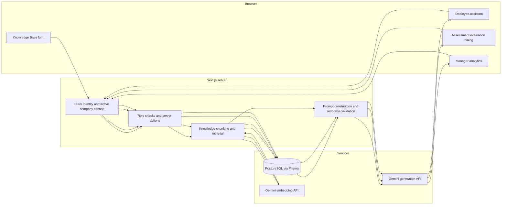

# Ascent AI Workflow Flow

This document describes the implemented company knowledge assistant and manager AI tools.

## 1. Add company onboarding material

Company admins and managers can add source material at **Dashboard > Knowledge Base**.

**Input details:** the title must contain at least 3 characters; pasted text must contain 30 to 50,000 characters. The app splits material into chunks and limits embedding requests to batches of four. Each chunk stores its title, text, embedding, company ID, and creator membership ID. Records are scoped to the active company.

**Current limitation:** material is pasted as text; PDF or Word upload and automatic document extraction are not included.

## 2. Employee asks the onboarding assistant

The assistant is instructed to use only retrieved company material, say when it cannot find an answer, and avoid giving away practice assessment answers. If the company has not added material, the app asks the employee to contact their manager. Gemini output is advisory and can still be wrong, so the response includes a reminder to verify it against the source or with a manager.

## 3. Manager gets written-answer grading suggestions

Only short-answer and long-answer responses are sent for suggestions. Suggestions are not saved or released automatically. Managers must review them; they can edit every score and comment before saving or releasing.

## 4. Manager reviews recurring forum questions

Analysis covers up to 100 recent open or answered threads. It excludes employee names and emails from the prompt. Results are suggestions for managers, not saved decisions.

## Architecture overview

## To run these flows

1. Set `GEMINI_API_KEY` in `.env`.
2. Make sure the PostgreSQL database is reachable.
3. Apply the Prisma schema with `npx prisma db push` if the knowledge table has not been created.
4. Start the app with `npm run dev`.
5. Add company material, then ask an employee question to exercise the retrieval flow.

Relevant implementation: `src/lib/ai/gemini.ts`, `src/app/dashboard/company/knowledge/`, `src/app/dashboard/assistant/`, `src/app/dashboard/assessments/actions.ts`, and `src/app/dashboard/analytics/`.
