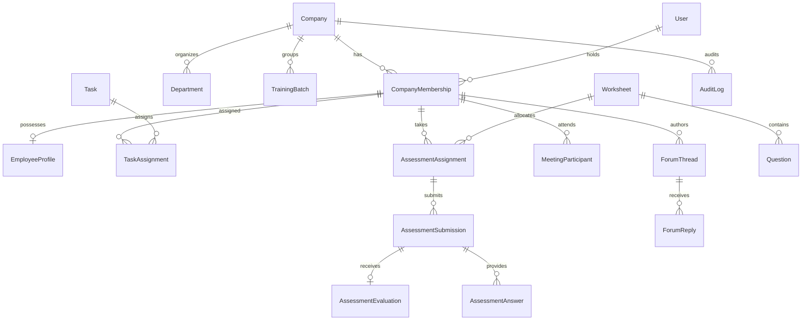

# Ascent — Enterprise Employee Onboarding & Performance Platform

[](https://nextjs.org/)
[](https://react.dev/)
[](https://www.typescriptlang.org/)
[](https://tailwindcss.com/)
[](https://www.prisma.io/)
[](https://neon.tech/)
[](https://clerk.com/)
[](https://nodejs.org/)

**Ascent** is a production-grade, multi-tenant enterprise web platform engineered to manage the entire lifecycle of employee onboarding, structured training, collaborative scheduling, assessment evaluations, doubt resolution, and performance analytics.

Built with Next.js App Router, React 19, TypeScript, PostgreSQL (Neon), and Prisma ORM, Ascent enforces strict role-based access control (RBAC), tenant data isolation, and comprehensive auditability.

---

## 📑 Table of Contents

- [System Architecture & Tech Stack](#-system-architecture--tech-stack)
- [Key Features by Phase](#-key-features-by-phase)
  - [Phase 1: Foundation & RBAC](#phase-1-foundation--multi-tenant-rbac)
  - [Phase 2: Company, Employee & Manager Hierarchy](#phase-2-company-employee--manager-management)
  - [Phase 3: Task & Training Management Engine](#phase-3-task--training-management-engine)
  - [Phase 4: Schedule & Meeting Management](#phase-4-schedule--meeting-management)
  - [Phase 5: Worksheets, Assignments & Evaluations](#phase-5-worksheets-assignments--evaluations)
  - [Phase 6: Discussion Forum & Doubt Resolution](#phase-6-discussion-forum--doubt-resolution)
  - [Phase 7: Performance Analytics & Leaderboards](#phase-7-performance-analytics--leaderboards)
- [Performance Score Formula](#-performance-score-formula)
- [Role-Based Access Matrix](#-role-based-access-matrix)
- [Database Schema (Prisma)](#-database-schema-prisma)
- [Project Directory Structure](#-project-directory-structure)
- [Getting Started](#-getting-started)
  - [Prerequisites](#prerequisites)
  - [Installation](#installation)
  - [Environment Variables](#environment-variables)
  - [Database Setup](#database-setup)
  - [Running the Application](#running-the-application)
- [Testing & Quality Assurance](#-testing--quality-assurance)
- [License](#-license)

---

## 🛠 System Architecture & Tech Stack

- **Framework**: [Next.js 15 (App Router)](https://nextjs.org/) with React 19 Server Components & Server Actions.
- **Language**: [TypeScript 5.8](https://www.typescriptlang.org/) with strict type checking and zero compilation errors.
- **Authentication & Identity**: [Clerk](https://clerk.com/) for secure authentication, multi-factor login, and webhook/session syncing.
- **Database & Pooling**: [Neon Serverless PostgreSQL](https://neon.tech/) with pooled and direct connection support.
- **ORM & Migrations**: [Prisma ORM 6.4](https://www.prisma.io/) with custom indexes, cascade rules, and relational schemas.
- **Styling & Design System**: [Tailwind CSS](https://tailwindcss.com/) with a curated warm editorial palette, dark mode support, accessible forms, badges, modals, and responsive data tables.
- **Email Service**: Dual support for [Resend API](https://resend.com/) and standard SMTP via [Nodemailer](https://nodemailer.com/) for invitations and notifications.
- **Validation**: [Zod](https://zod.dev/) schemas enforcing server-side runtime boundary validation.
- **Automated Testing**: Node.js Native Test Runner with [tsx](https://github.com/privatenumber/tsx) covering business logic, auto-grading, collision detection, and performance weighting.

---

## 🚀 Key Features by Phase

### Phase 1: Foundation & Multi-Tenant RBAC
- **Multi-Tenant Isolation**: Explicit company context prevents data leaks between organizations.
- **Dual-Layer Roles**:
  - **Global Roles**: `PLATFORM_ADMIN` vs `USER`.
  - **Company Roles**: `COMPANY_ADMIN`, `MANAGER`, and `EMPLOYEE`.
- **Clerk Synchronization**: Automated sync between external Clerk identity and local database records.
- **Onboarding Flow**: Guided workspace onboarding and profile activation for invited team members.
- **Audit Trails**: Global and tenant-level logging tracking administrative operations.

### Phase 2: Company, Employee & Manager Management
- **Directory Management**: Searchable, filterable, and paginated employee directory with avatar badges and department tags.
- **Organizational Structure**: Flexible Department hierarchies and Cohort Training Batches.
- **Reporting Lines**: Primary manager assignments with audit-logged reassignment workflows.
- **Status Lifecycle**: Support for `ACTIVE`, `PENDING`, `INVITED`, and `DEACTIVATED` memberships without cascading data loss.
- **Invitations**: One-click employee onboarding invitations delivered via customizable email templates.

### Phase 3: Task & Training Management Engine
- **Task Types**: Daily operational tasks, training activities, recurring tasks, templates, and historical onboarding records.
- **Assignment Engine**: Assign tasks to individuals or batches with start dates, due dates, priority tiers, instructions, and file resources.
- **Employee Workflow**: Personal checklist with submission notes, attached URLs/files, and deadline countdowns.
- **Manager Review Queue**: Review submitted work, approve deliverables, provide feedback, or request revisions with real-time status updates (`SUBMITTED` -> `UNDER_REVIEW` -> `COMPLETED` / `CHANGES_REQUESTED`).

### Phase 4: Schedule & Meeting Management
- **Interactive Calendar**: Daily and weekly views of upcoming sessions with responsive agenda timelines.
- **Meeting Archetypes**: Training sessions, 1:1 check-ins, team syncs, and dedicated help sessions.
- **Conflict Detection Algorithm**: Server-side validation preventing overlapping bookings for organizers or participants.
- **Attendance Lifecycle**: Invitations with `INVITED`, `ACCEPTED`, `DECLINED`, and `ATTENDED` status tracking.
- **Doubt Escalation**: One-click conversion of unresolved employee doubts into scheduled Google Meet / Zoom help sessions.

### Phase 5: Worksheets, Assignments & Evaluations
- **Dynamic Worksheets**: Support for mixed question types:
  - Multiple Choice Questions (MCQ)
  - Short Answer (Conceptual)
  - Long Answer (Analysis)
  - File / Code Upload (URL & Repository submissions)
- **Objective Auto-Grading**: Exact-match auto-grading for MCQs with encrypted correct options shielded from employee inspection.
- **Subjective Rubrics**: Manager grading rubrics with per-question marks and criteria comments.
- **Attempt Immutability & Resubmission**: Historical attempts preserved across resubmissions. Draft submissions can be saved and finalized later.
- **Anti-Leakage Safeguards**: Draft evaluations remain hidden until managers explicitly release grades to employees.

### Phase 6: Discussion Forum & Doubt Resolution
- **Topic Channels**: Thread categorization across `GENERAL`, `TECHNICAL`, `ONBOARDING`, `TASK_QUERY`, `WORKSHEET_QUERY`, and `POLICY`.
- **Solution Verification**: Author or manager can accept a reply as the official verified solution.
- **Entity Linking**: Forum threads can reference specific tasks, worksheets, or scheduled meetings.
- **Safety & Moderation**: Reporting workflow with moderator hide/restore capabilities.

### Phase 7: Performance Analytics & Leaderboards
- **Operational Metrics**:
  - Total assigned tasks, completion rates, and overdue tallies.
  - On-time delivery rate calculated against assignment deadlines.
  - Graded assessment mastery averages (excluding drafts/ungraded work).
  - Pending review counts and upcoming evaluations.
  - Unanswered forum doubts counter.
- **4-Week Velocity Trends**: Real timestamp queries graphing task completion and evaluation release volumes over the last 4 weeks.
- **Cohort Leaderboards**: Ranked standings with Top 3 Gold/Silver/Bronze medals, score badges, and department filtering.
- **Personal Scorecards**: Direct insights for individual employees showing their rank and peer standing.

---

## 📊 Performance Score Formula

Ascent uses a transparent, mathematically rigorous formula to evaluate employee performance without arbitrarily mixing disparate metrics:

### 1. Weighting Rules

| Data Availability | Assessment Weight | Task Completion Weight | On-Time Delivery Weight |
| :--- | :---: | :---: | :---: |
| **Both Tasks & Graded Assessments** | **45%** | **35%** | **20%** |
| **Tasks Only (No Tests Graded)** | — | **65%** | **35%** |
| **Assessments Only (No Tasks Assigned)** | **100%** | — | — |
| **Insufficient Data (Neither Assigned)** | *null* (Unranked) | *null* | *null* |

### 2. Fairness & Integrity Rules
- **Anti-Double-Counting**: When an employee resubmits an assessment, only the latest attempt (`attemptNumber desc`) is calculated. Previous attempts do not dilute or inflate scores.
- **Ungraded Exclusion**: Only assessments with `evaluation.status === "RELEASED"` factor into graded averages.
- **Genuine Zero vs. Insufficient Data**: An employee who attempts work and scores 0 marks receives a legitimate `0%` score, whereas an employee with no work assigned is marked `null` (*Insufficient Data*) and placed at the bottom without rank distortion.
- **Deterministic Tie-Breaking**: Ties in composite score are broken first by higher assessment score average, and second by higher on-time delivery rate.

---

## 🔐 Role-Based Access Matrix

| Feature / Resource | Platform Admin | Company Admin | Manager | Employee |
| :--- | :---: | :---: | :---: | :---: |
| Global Organizations & Audit Trail | ✅ Full Access | ❌ Denied | ❌ Denied | ❌ Denied |
| Company Employee Directory | ❌ Private | ✅ Manage All | 👁 Direct Reports | 👁 Peer Directory |
| Department & Batch Management | ❌ Private | ✅ Create / Edit | 👁 View Only | 👁 View Only |
| Task Creation & Assignment | ❌ Private | ✅ All Teams | ✅ Direct Reports | ❌ Denied |
| Task Completion & Submissions | ❌ Private | ❌ | 👁 Review Queue | ✅ Personal Tasks |
| Meeting Scheduling & Calendars | ❌ Private | ✅ Company-wide | ✅ Direct Reports | 👁 Invited Only |
| Worksheet Creation & Rubrics | ❌ Private | ✅ Company-wide | ✅ Team Scope | ❌ Denied |
| Assessment Taking & Submissions | ❌ Private | ❌ | ❌ | ✅ Assigned Tests |
| Evaluation & Grading Queue | ❌ Private | ✅ All Work | ✅ Assigned Work | 👁 Released Grades |
| Discussion Forum & Doubts | ❌ Private | ✅ Moderate | ✅ Reply / Solve | ✅ Ask / Discuss |
| Analytics & Leaderboards | 👁 Platform Telemetry | ✅ Company Scope | ✅ Team Scope | 👁 Personal & Cohort |

---

## 🗄 Database Schema (Prisma)

Ascent's data model in [`prisma/schema.prisma`](file:///c:/Users/HP/Desktop/code/college_assingments/minor_project/prisma/schema.prisma) includes 17 relational entities:



---

## 📁 Project Directory Structure

```text
minor_project/
├── prisma/
│   ├── schema.prisma        # Complete PostgreSQL Prisma schema
│   └── seed.ts              # Database seeding script
├── src/
│   ├── app/
│   │   ├── (auth)/          # Clerk sign-in and sign-up routes
│   │   ├── dashboard/
│   │   │   ├── admin/       # Platform Admin operations
│   │   │   ├── analytics/   # Performance reports & leaderboards (Phase 7)
│   │   │   ├── assessments/ # Worksheets & evaluations (Phase 5)
│   │   │   ├── company/     # Members, departments, batches, audit logs (Phase 2)
│   │   │   ├── employee/    # Checklist, profile, training views
│   │   │   ├── forum/       # Discussion forum & doubt resolution (Phase 6)
│   │   │   ├── manager/     # Direct reports, reviews, department progress
│   │   │   ├── schedule/    # Meeting calendar & sessions (Phase 4)
│   │   │   ├── tasks/       # Tasks & training manager (Phase 3)
│   │   │   └── page.tsx     # Role-based root dashboard dispatcher
│   │   ├── onboarding/      # New user invitation & company onboarding flow
│   │   ├── globals.css      # Design system CSS tokens & styles
│   │   └── layout.tsx       # Root layout with ClerkProvider
│   ├── components/
│   │   ├── analytics/       # AnalyticsDashboardView component
│   │   ├── assessments/     # AssessmentManagerView & AssessmentEmployeeView
│   │   ├── company/         # EmployeeDirectoryTable
│   │   ├── dashboard/       # Dedicated dashboards per role
│   │   ├── forum/           # ForumThreadListView & ForumThreadDetailView
│   │   ├── layout/          # Header, Sidebar, navigation
│   │   ├── schedule/        # ScheduleCalendarView
│   │   └── ui/              # Button, Card, Badge, Input, Select, EmptyState, Alert
│   ├── lib/
│   │   ├── analytics/       # Composite score engine, trends, and leaderboard sorting
│   │   ├── audit.ts         # Centralized audit logging helper
│   │   ├── auth.ts          # Server-side auth, session sync, and RBAC enforcer
│   │   ├── db.ts            # Prisma client singleton
│   │   ├── email/           # Resend & SMTP mailers and HTML templates
│   │   ├── utils.ts         # Class merging (cn) and date formatting
│   │   └── validations/     # Zod runtime schemas (tasks, schedule, assessment, forum)
│   └── middleware.ts        # Clerk route protection & public route whitelist
├── tests/
│   ├── analytics.test.ts    # Phase 7 analytics & leaderboard test suite
│   ├── assessment.test.ts   # Phase 5 worksheet & grading test suite
│   ├── forum.test.ts        # Phase 6 forum & doubts test suite
│   └── schedule.test.ts     # Phase 4 schedule & conflict detection test suite
├── package.json
├── tailwind.config.ts
└── tsconfig.json
```

---

## 🚦 Getting Started

### Prerequisites

- [Node.js](https://nodejs.org/) v18.18 or higher (v20+ recommended).
- A [Neon Database](https://neon.tech/) account (or any PostgreSQL instance).
- A [Clerk](https://clerk.com/) application for authentication keys.

### Installation

1. **Clone the repository**:
   ```bash
   git clone https://github.com/Rishabh503/Minor-Project.git
   cd Minor-Project
   ```

2. **Install dependencies**:
   ```bash
   npm install
   ```

### Environment Variables

Create a `.env` file in the root directory based on `.env.example`:

```env
# Clerk Authentication
NEXT_PUBLIC_CLERK_PUBLISHABLE_KEY="pk_test_..."
CLERK_SECRET_KEY="sk_test_..."
NEXT_PUBLIC_CLERK_SIGN_IN_URL="/sign-in"
NEXT_PUBLIC_CLERK_SIGN_UP_URL="/sign-up"
NEXT_PUBLIC_CLERK_AFTER_SIGN_IN_URL="/dashboard"
NEXT_PUBLIC_CLERK_AFTER_SIGN_UP_URL="/onboarding"

# Neon PostgreSQL Database
DATABASE_URL="postgresql://[user]:[password]@[neon_hostname]/neondb?sslmode=require"
DIRECT_URL="postgresql://[user]:[password]@[neon_hostname]/neondb?sslmode=require"

# Application Settings
NEXT_PUBLIC_APP_NAME="Ascent Onboarding"
NEXT_PUBLIC_APP_URL="http://localhost:3000"

# Email Configuration (Optional - for Invitations)
RESEND_API_KEY="re_..."
EMAIL_FROM="Ascent Onboarding <onboarding@resend.dev>"
```

### Database Setup

Generate the Prisma Client and synchronize your PostgreSQL database:

```bash
# Generate Prisma Client
npm run prisma:generate

# Push database schema to Neon
npx prisma db push

# (Optional) Seed initial data
npm run prisma:seed
```

### Running the Application

```bash
# Start the local development server
npm run dev
```

Open [http://localhost:3000](http://localhost:3000) in your browser.

---

## 🧪 Testing & Quality Assurance

Ascent includes an automated test suite executed with the native Node.js test runner:

```bash
# Run all unit, boundary, and validation tests
npm test
```

### Test Suite Coverage:
- **Phase 7 (`tests/analytics.test.ts`)**: Composite weighting formulas, resubmission deduplication, genuine zero vs insufficient data distinctions, and leaderboard tie-breaking.
- **Phase 6 (`tests/forum.test.ts`)**: Thread life cycles, reply validation, solution verification, cross-tenant access denial, and content reporting.
- **Phase 5 (`tests/assessment.test.ts`)**: Worksheet schemas, objective auto-grading, rubric score limits, anti-leakage hiding of correct answers, and evaluation draft privacy.
- **Phase 4 (`tests/schedule.test.ts`)**: Meeting durations, interval conflict detection algorithms, and timezone handling.

### TypeScript Compilation & Production Build:
```bash
# Validate strict type checking
npx tsc --noEmit

# Compile production bundle
npm run build
```

---

## 📄 License

This project is developed as part of an academic minor project capstone. Distributed under the MIT License.
